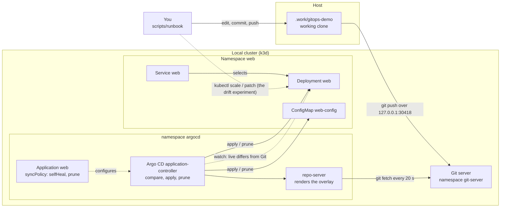

# Architecture: a cluster that follows a Git repository

This document describes what is in this repository and why it is shaped this way. Component names match the diagram in the lesson ("A cluster that follows a Git repository"): **You**, **gitops-demo**, **Argo CD or Flux** (Argo CD here, Flux in the comparison), **Deployment web**, **ConfigMap web-config** and **Service web**, all inside **Local cluster (k3d or kind)**, **Namespace web**.

## Components and what each owns

| Component | Where it lives | What it owns |
| --- | --- | --- |
| **You** | the scripts under [`scripts/runbook`](scripts/runbook), run by hand or by `make run` | The only way into the cluster: edit a file in the working clone, commit, push. The one exception is the lesson's own experiment, a `kubectl scale` and a `kubectl patch` made on purpose to create drift. |
| **gitops-demo** | the repository served by the Git server; its content is [`manifests/`](manifests), copied into `.work/gitops-demo` by [`scripts/seed-repo.sh`](scripts/seed-repo.sh) | The desired state: `apps/web/base` (Namespace, ConfigMap, Deployment, Service, a `kustomization.yaml`), `apps/web/overlays/local` (the image tag) and `clusters/local` (the Argo CD project and application). History is the audit trail, including rollbacks. |
| **Git server** | [`docker/git-server`](docker/git-server), deployed by [`platform/git-server`](platform/git-server) | Smart-HTTP access to the repository for the controller (inside the cluster) and for the runbook (through a loopback port). Owns no policy. See [ADR 0002](docs/adr/0002-an-in-cluster-git-server.md). |
| **Argo CD or Flux** | Argo CD v3.5.6 from [`platform/argocd`](platform/argocd); Flux v2.10.0 from [`platform/flux`](platform/flux) for the comparison | Pulls the repository, renders the overlay, compares it with the live objects, applies, prunes and reports sync and health. Owns the `Application` (or Flux `Kustomization`), whose `syncPolicy` is the switch for self-heal and prune. |
| **AppProject gitops-demo** | [`manifests/clusters/local/project.yaml`](manifests/clusters/local/project.yaml) | Least privilege for the controller: one source repository, one destination namespace, one cluster-scoped kind (Namespace). |
| **Deployment web** | [`manifests/apps/web/base/deployment.yaml`](manifests/apps/web/base/deployment.yaml) | Two replicas of `plainround/web`, non-root, read-only root filesystem, limits, probes, a 60-second progress deadline so a bad rollout turns "Degraded" quickly. |
| **ConfigMap web-config** | [`.../configmap.yaml`](manifests/apps/web/base/configmap.yaml) | `GREETING`, read into the container's environment at start. |
| **Service web** | [`.../service.yaml`](manifests/apps/web/base/service.yaml) | Port 80 to the pods' named port `http`. |
| **Local cluster (k3d)** | [`scripts/provider.sh`](scripts/provider.sh), [`scripts/cluster-up.sh`](scripts/cluster-up.sh) | One control-plane node (k3s v1.35.5 by default, `kindest/node` with `CLUSTER_PROVIDER=kind`), the Git server's NodePort published on `127.0.0.1:30418`. [ADR 0006](docs/adr/0006-k3d-by-default-kind-optional.md). |
| **Images** | [`docker/web`](docker/web), [`scripts/build-images.sh`](scripts/build-images.sh) | `plainround/web:1.0.0` and `:1.1.0` (the same nginx with a different printed version) and `plainround/git-server:1.0.0`, built locally and loaded into kind. [ADR 0003](docs/adr/0003-images-built-locally-and-loaded-into-the-cluster.md). |
| **Tests** | [`tests/`](tests) | Offline: helper code and manifest conformance. Cluster: one module per lesson step that runs the runbook script and asserts on the controller and the cluster. |

## Pattern: pull-based reconciliation, and a runbook that is code

The controller *pulls*: nothing outside the cluster holds credentials to it. Everything the controller deploys is rendered from one Git revision, so "which commit is this running from" has one answer (the Application's `status.sync.revision`, and `status.history` for earlier ones).

The runbook is the second pattern. Each step of the lesson is a script that does the work and prints what it saw; the tests call the same scripts and then assert on the result, so `make run` and `make test` cannot drift apart ([ADR 0004](docs/adr/0004-the-runbook-is-scripts-and-the-tests-call-them.md)). The test helpers take the clock, the sleep and `kubectl` as parameters, which is how their own unit tests run in milliseconds.

## Data flow

### One run, step by step (`make run`)

1. `scripts/reset.sh` deletes the Application (its finalizer removes the workload) and the namespace, reseeds the repository from `manifests/` as one commit and applies the project and the Application with self-heal and prune off. The controller deploys the app; no `kubectl apply` of a workload manifest happens (the managed-fields check in the tests shows `argocd-controller` as the writer).
2. `02-change-through-git.sh` edits the base (3 replicas, greeting `hi there`, config revision 2), commits and pushes through the pre-push hook, which runs `kubeconform` on the rendered overlay. The repo-server fetches within 20 seconds, renders, and the application-controller applies. The script waits until the Application reports Synced and Healthy at the new commit and prints the commit that each running object came from.
3. `03-drift.sh off` turns self-heal off, runs `kubectl scale` and `kubectl patch`, and shows the Application go OutOfSync with the difference (`scripts/diff.sh`, a `kubectl diff` of the rendered overlay against the live objects). Forty-five seconds later the objects are still changed. `03-drift.sh on` sets `selfHeal: true`: the controller's watch sees the live objects differ and reverts both, and the script measures how long that takes.
4. `04-prune.sh off` removes `configmap.yaml` and its line in `kustomization.yaml`. With prune off the ConfigMap stays and the Application lists it as needing pruning. `04-prune.sh on` sets `prune: true` and the ConfigMap is deleted. `04-prune.sh restore` is a `git revert` of the deletion.
5. `05-break-and-rollback.sh bad` commits image 1.1.0 together with a readiness probe on a path that does not exist. The new pod never becomes ready, the old pods keep serving (`maxUnavailable: 0`), and after the 60-second progress deadline the Application is Degraded. `... rollback` is a `git revert` and a push; the previous image comes back and the Application is Healthy, with no command run against the cluster.
6. `06-bad-manifest.sh` commits `replicas: "many"`. The pre-push hook refuses the push. With `--no-verify` the push succeeds, the API server refuses the apply, the Application reports the failed operation, and the live Deployment keeps its last good state.

## Decisions and trade-offs

**Argo CD for the main run, Flux for the comparison.** Argo CD exposes self-heal and prune as two switches on one object, which is exactly what steps 3 and 4 toggle; Flux has no self-heal switch to show "off". [ADR 0001](docs/adr/0001-argo-cd-as-the-controller.md). Flux still runs, in a second cluster, to prove the comparison table (`make compare`).

**Kustomize base and overlay, though the lesson has one folder.** The task of the track is the layout the lesson teaches (`clusters/`, `apps/`, `base/`, `overlays/`), and the overlay is where the image tag lives, so the rollback restores a one-line value.

**A Git server in the cluster.** No account, no token, nothing public. The cost is no authentication on a loopback-only port. [ADR 0002](docs/adr/0002-an-in-cluster-git-server.md).

**A 20-second poll.** The default is three minutes plus jitter. [ADR 0005](docs/adr/0005-a-twenty-second-poll-interval.md).

**Environment variables need a pod-template change.** A ConfigMap edit alone does not restart pods; the lesson's step 2 would print the old greeting. The Deployment's pod template carries a `plainround.dev/config-revision` annotation that the same commit bumps, which makes the rollout part of the commit instead of a manual `rollout restart`.

**`progressDeadlineSeconds: 60`.** Without it the Deployment stays "Progressing" for ten minutes after a bad commit, and the controller never says Degraded in a lesson-sized wait.

**`maxUnavailable: 0`.** The bad rollout never removes a ready pod, which is why the test can show the old version still answering while the controller reports Degraded.

**Pod Security `restricted` on the namespace.** The Deployment is written to pass it (non-root, no privilege escalation, all capabilities dropped, seccomp default). A manifest that broke the rule would be refused by the cluster at admission.

## Failure modes the lesson teaches, and how the code shows them

| Failure | What you see | How to reproduce |
| --- | --- | --- |
| **Manual edit behind Git's back** | OutOfSync with self-heal off; reverted within seconds with self-heal on | `scripts/runbook/03-drift.sh off`, then `on` |
| **A deleted file** | The object stays, flagged, with prune off; removed with prune on | `scripts/runbook/04-prune.sh off`, then `on` |
| **A deletion that removes something a Deployment needs** | Running pods keep their environment; a new pod would fail with a missing ConfigMap | `04-prune.sh on`, then `kubectl -n web rollout restart deploy/web` |
| **A bad deployment** | Degraded, old pods still serving | `scripts/runbook/05-break-and-rollback.sh bad` |
| **A rollback by `kubectl edit`** | The controller undoes it on the next sync (with self-heal on) and the repository has no record | try `kubectl -n web set image deploy/web web=plainround/web:1.0.0` during step 5 with self-heal on |
| **An invalid manifest** | Hook refusal; failed operation with the API server's message | `scripts/runbook/06-bad-manifest.sh` |
| **The poll interval** | A change that "didn't take" after ten seconds | change `timeout.reconciliation` in `platform/argocd/controller-settings.yaml` |

## Limits of the teaching build against production

- **One node, no high availability:** one control-plane node, one controller replica, an `emptyDir` for the Git server. Production runs the controller sharded or replicated and the repository on a hosted service with branch protection.
- **No authentication on Git:** the in-cluster server accepts any push from the host loopback. Production uses SSH keys or tokens per controller, with read-only access.
- **The Application is applied by a script:** production bootstraps the controller from Git too (an app-of-apps); here it is the lesson's third stretch goal.
- **Self-heal and prune both on at the end:** the lesson turns them on to watch them work; production leaves prune off for anything that holds data.
- **Images from a local build:** no registry, no signing, no scan. The next project in the track (environments and secrets) promotes by digest.
- **A 20-second poll:** a hosted repository would call a webhook and the poll would be a fallback.

## How to extend it

- **A second app:** add `apps/<name>/base` and `overlays/local`, and a second Application in `clusters/local`; extend the AppProject destinations.
- **A Helm chart as a second source:** add an Application whose `source.chart` pins the chart version, and add the chart repository to `sourceRepos`.
- **Manage the controller from Git:** move `project.yaml` and `application.yaml` under an app-of-apps Application and delete `scripts/bootstrap.sh`'s `apply`.
- **Notifications:** re-enable the notifications controller in `platform/argocd/kustomization.yaml` and add a webhook trigger on `on-sync-failed`.
- **A real repository:** change `repoURL` in the Application, add the repository to the project, and add a credential Secret in the `argocd` namespace.
